# RR310 Connect — beta releases

An **unofficial** companion app for the **TVS Apache RR 310 (2022–23 model)**. Not made by or affiliated with
TVS Motor Company.

  <picture><source media="(prefers-color-scheme: dark)" srcset="screenshots/dark/01_home.jpg">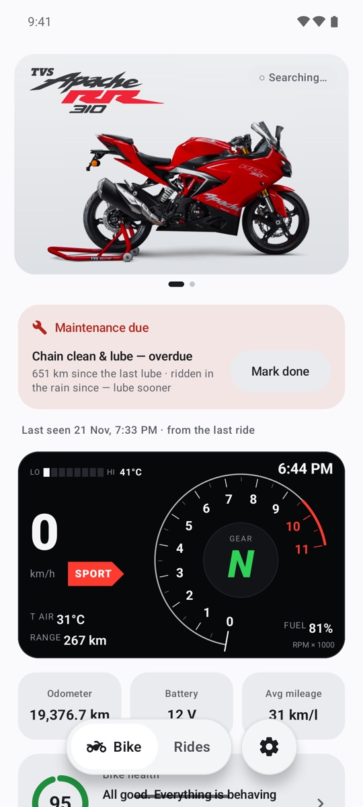</picture>
  <picture><source media="(prefers-color-scheme: dark)" srcset="screenshots/dark/07_ride.jpg">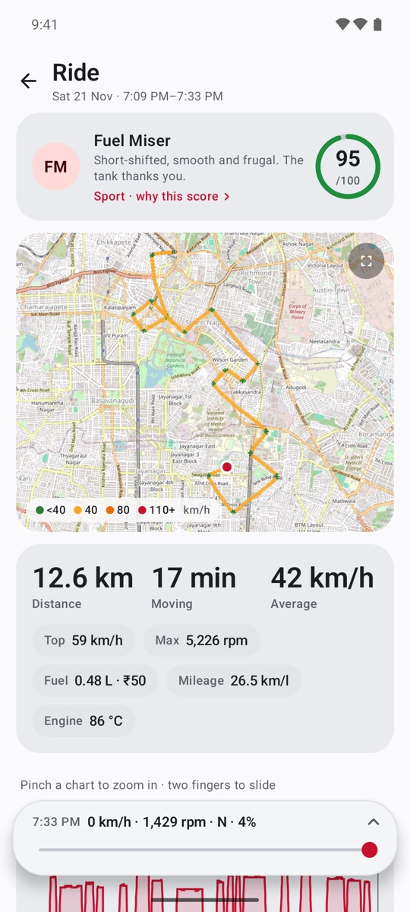</picture>
  <picture><source media="(prefers-color-scheme: dark)" srcset="screenshots/dark/08_score.jpg">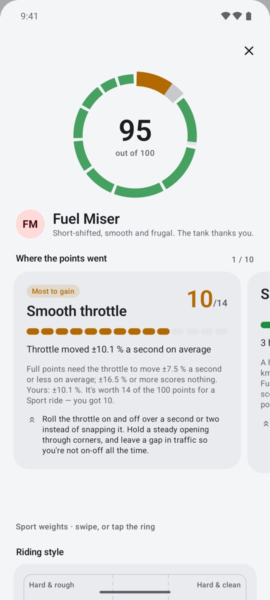</picture>

Screenshots use made-up demo rides, and follow your GitHub theme (light or dark).

**[⬇ Download the latest release](https://github.com/adarshrajendran0/RR310-Connect-releases/releases/latest)** ·
[Install guide](#install-first-time--with-obtainium) · [How to use it](#how-to-use-it) · [Dash styles](#dash-styles)

## Connects by itself — the feature everything else builds on
Pair your bike once. From then on, **switch the ignition on and the app connects on its own** — no opening the
app, no tapping "connect", the phone stays in your pocket. It reconnects after a drop, keeps listening after the
phone restarts or the app updates, and saves battery while the bike is off.

That's what makes the rest seamless:
- **Google Maps turn-by-turn on the cluster** — start navigation as usual; arrows and distances appear on the dash
- **Every ride recorded automatically** — map, charts, fuel and mileage, and a **ride score** for every ride
- **Bike health** learned from your own rides, **maintenance reminders**, a **fuel log** with refuels found
  automatically, **service reminders**
- **Documents on the bike's screen** (licence, RC, insurance), **several bikes**, **your own bike photo**
- **Bike warnings**, **call alerts** (answer from the handlebar), DJI Osmo Action recording
- Smooth and modern: Material 3 Expressive motion, predictive back, light and dark themes

---

## How to use it

### 1 · Home — your bike at a glance
<picture><source media="(prefers-color-scheme: dark)" srcset="screenshots/dark/01_home.jpg"></picture>

- The **bike card** shows whether it's connected (*Searching…* while the bike is off). Put **your own photo** on it
  (Settings › Appearance › Bike photo).
- **Maintenance due** — chain, tyres or service — shows right under the bike, with **Mark done**.
- The **dash** mirrors the cluster live while you ride; when the bike is off you see the last known values. Tap it for
  **full screen** (landscape, screen kept on). Seven [dash styles](#dash-styles) to choose from.
- **Bike health** — the score, the verdict and the one thing worth looking at. Tap for the full page.

 

### 2 · More than one bike
- **Swipe the bike photo left** for your next bike, or the **+ Add a bike** card at the end. Each bike keeps its own
  rides, fuel log, health, service, documents, photo and parking spot.
- **Whichever bike you switch on connects**, and the app shows it. If you swipe to another bike that's on nearby while
  the connected one is parked, the connection moves over — never mid-ride.

### 3 · Further down the home page
<picture><source media="(prefers-color-scheme: dark)" srcset="screenshots/dark/02_home_lower.jpg">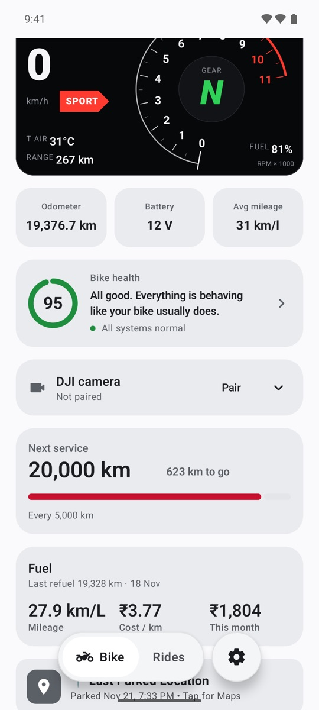</picture>

- **Next service** — counts down to the next 5,000 km service.
- **Fuel** — mileage, cost per km and this month's spend. Tap for the fuel log.
- **Last parked location** — saved when you switch off; tap to open it in Google Maps.
- **Start Navigation** — opens Google Maps; directions then show on the cluster by themselves.

 

### 4 · Rides — every ride, recorded for you
<picture><source media="(prefers-color-scheme: dark)" srcset="screenshots/dark/06_rides.jpg">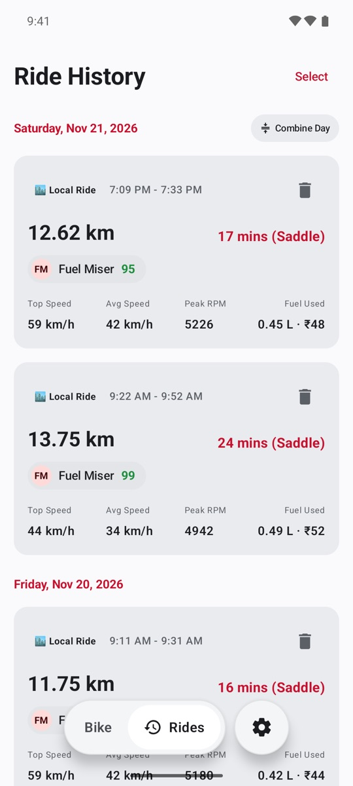</picture>

Nothing to start or stop: a ride begins when you move off and ends after you've switched off (a break of up to 2 hours
doesn't split it — and an app update in that break loses nothing).
- Each ride: distance, saddle time, speeds, peak revs, fuel used, and its **character and score**.
- **Combine Day** joins a day's short hops into one ride (and can split them again).

 

### 5 · A ride
<picture><source media="(prefers-color-scheme: dark)" srcset="screenshots/dark/07_ride.jpg"></picture>

- The **map** is coloured by speed; ⛶ for full screen.
- Distance, moving time, average and top speed, peak revs, **fuel used and km/l**, engine temperature.
- **Charts** for speed, revs, throttle, temperature: **pinch to zoom**, two fingers to slide; the slider scrubs
  through the ride second by second.

 

### 6 · Ride score — why you got that score
<picture><source media="(prefers-color-scheme: dark)" srcset="screenshots/dark/08_score.jpg"></picture>

Tap **why this score** on a ride.
- The **ring is the score, built from its factors**: each segment is one factor (its length is how much it counts in
  that ride mode), the coloured part is the points you earned — amber means room to improve.
- **Swipe the factor cards** (the ring lights up the one you're on) or **tap a ring segment**. Each card: the points as
  pips, what was measured, why it scored that, and **how to earn more**.
- The **riding-style map** shows where the ride sits — hard or easy, rough or clean — and your **character** sums it up.
- Judged **against the ride mode**: the same riding earns more in Track than in Rain. Close with ✕ or Back.

 

### 7 · Bike health
<picture><source media="(prefers-color-scheme: dark)" srcset="screenshots/dark/05_health.jpg">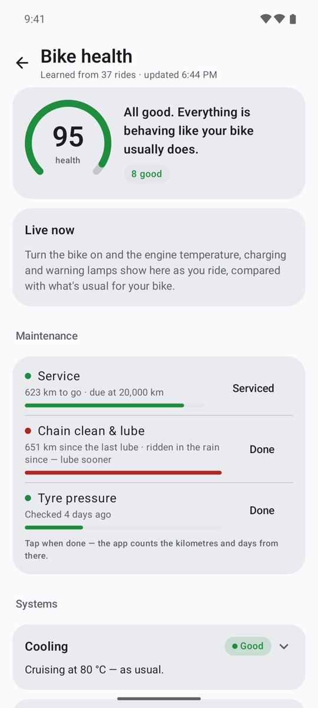</picture>

The app learns what's **normal for your bike** from your own rides — cruising temperature, warm-up time, charging,
braking, mileage — and tells you when something drifts.
- **Maintenance** first (chain, tyres, service — tap when done), then each **system**: collapsed, a card shows what
  needs attention (red first); tap for the trend and details.

 

### 8 · Settings, documents and what's coming
<picture><source media="(prefers-color-scheme: dark)" srcset="screenshots/dark/12_settings.jpg">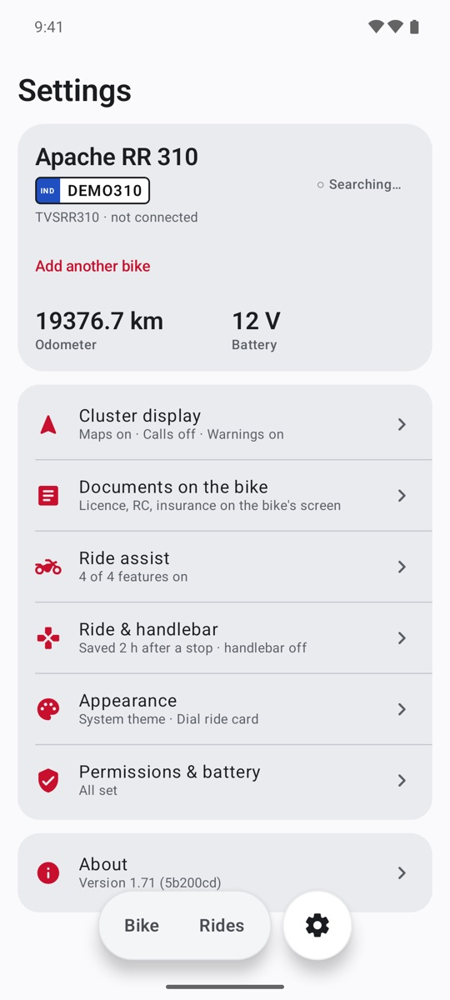</picture>

- **Cluster display** — Google Maps directions, bike warnings, calls on the cluster, answer with the handlebar.
- **Documents on the bike** — scan or photograph your licence, RC and insurance and send them to the bike's screen
  (parked, ignition on).
- **Appearance** — theme, ride card style, your bike photo.
- **About** — changelog, **Check for updates**, **Back up** / **Restore**, **Future features** (what's being worked on,
  and **Suggest a feature**), *Report a problem*.

 

<picture><source media="(prefers-color-scheme: dark)" srcset="screenshots/dark/14_future.jpg">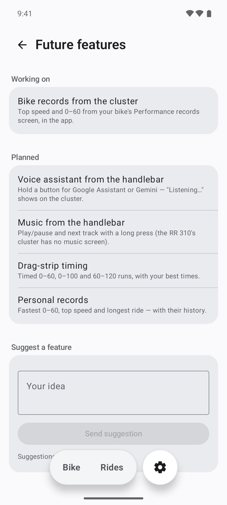</picture>

**Important notices:** when something needs your attention — a new version, a change — the app shows a notification
and a short message when you open it. New versions open the update page with one tap.

**Google Maps directions on the cluster** need *notification access*. On Android 13+ Android first blocks it for apps
installed outside the Play Store — the app walks you through *Allow restricted settings* with a button for each step.

 

## Dash styles

Pick one in Settings › Appearance › *Ride card*. Tap the dash on the home page for **full screen**:

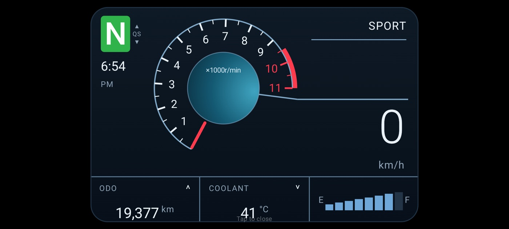

  <picture><source media="(prefers-color-scheme: dark)" srcset="screenshots/dash/dark_DIAL.jpg">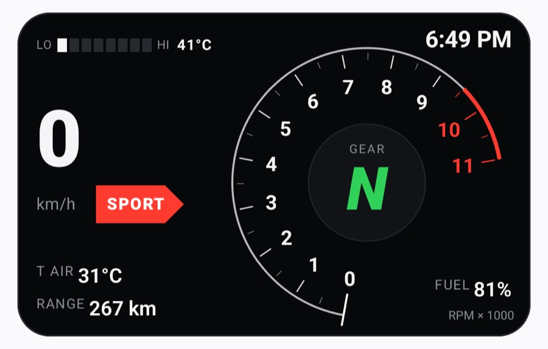</picture> <picture><source media="(prefers-color-scheme: dark)" srcset="screenshots/dash/dark_TFT.jpg">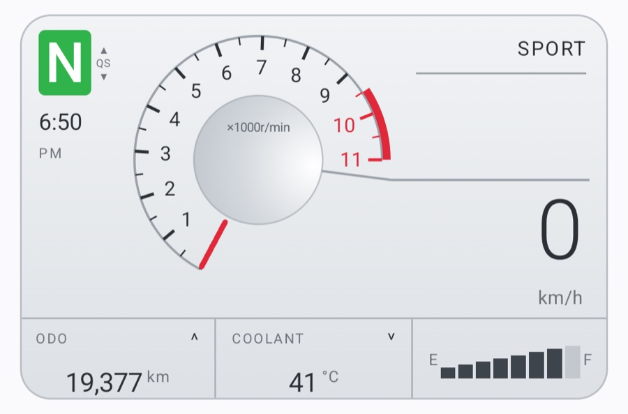</picture> 
  <picture><source media="(prefers-color-scheme: dark)" srcset="screenshots/dash/dark_RACE.jpg">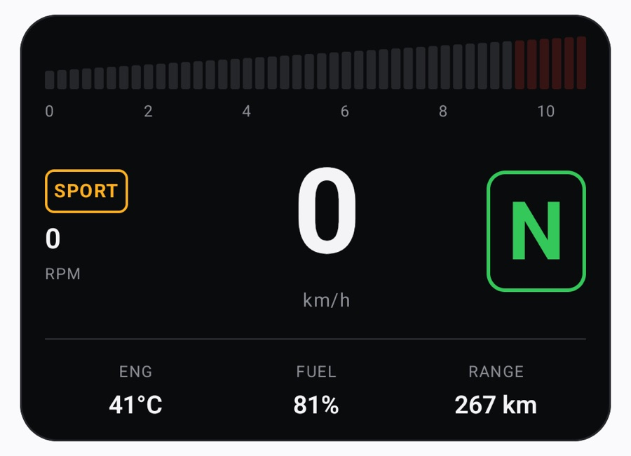</picture> <picture><source media="(prefers-color-scheme: dark)" srcset="screenshots/dash/dark_CURVE.jpg">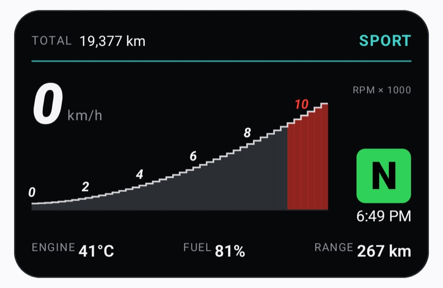</picture> 
  <picture><source media="(prefers-color-scheme: dark)" srcset="screenshots/dash/dark_SWEEP.jpg">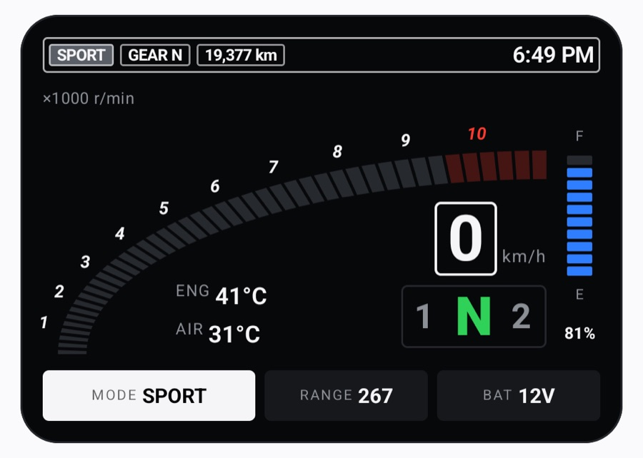</picture> <picture><source media="(prefers-color-scheme: dark)" srcset="screenshots/dash/dark_EDGE.jpg">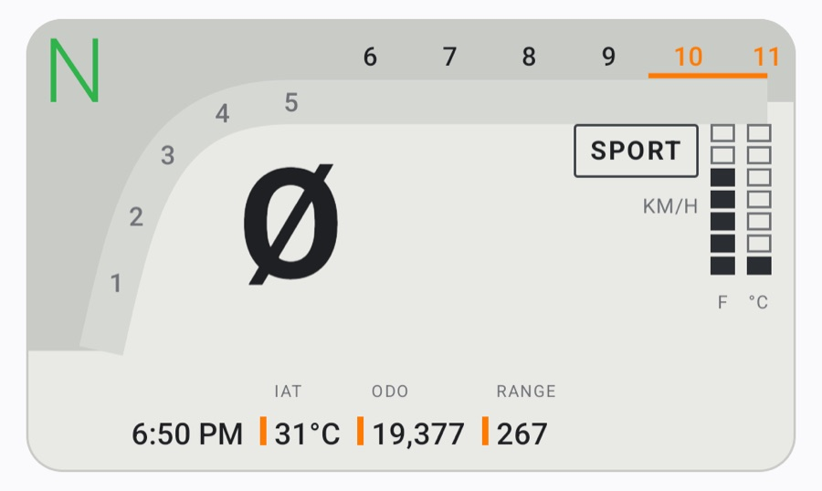</picture> 
  <picture><source media="(prefers-color-scheme: dark)" srcset="screenshots/dash/dark_CLASSIC.jpg">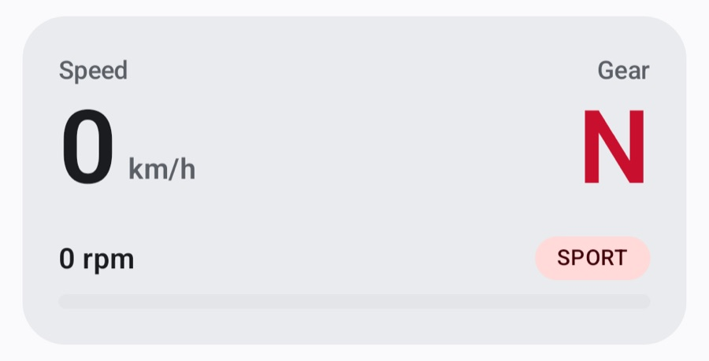</picture>

---

## Install (first time) — with Obtainium
In India, **Google Play Protect blocks this APK if you open it from a browser or the Files app** ("App blocked to
protect your device", only an OK button) — it does that to every sideloaded app that reads notifications, which
the app needs for Google Maps arrows. Installing through **Obtainium**, a free open-source app store that installs
straight from GitHub releases, works:

1. **Get Obtainium** from its [GitHub releases](https://github.com/ImranR98/Obtainium/releases/latest)
   (`app-arm64-v8a-release.apk` fits almost every phone from the last 6 years) or from F-Droid, and install it.
2. Open Obtainium › **Add app** › paste this page's address:
   `https://github.com/adarshrajendran0/RR310-Connect-releases` › **Add**.
3. Tap **Install**. The first time, Android asks to **allow Obtainium to install apps** — turn it on, go back.
4. If Play Protect shows **"App scan recommended"**: tap **Scan app** (takes a few seconds), or
   *More details › Install without scanning*.
5. Open **RR310 Connect**. It walks you through permissions and **Pair your bike** (ignition on, pick your
   "TVS…" cluster). Allow *Nearby devices*, *Location — all the time* and *Battery — unrestricted*: auto-connect
   needs them. For Google Maps directions, follow the notification-access steps above.

Works on Android 7 and newer. Have a computer with Android tools? `adb install RR310-Connect-v1.xx.apk` works too.

**Check the file** (optional): every release has a `.sha256` next to the APK — it must match
`sha256sum RR310-Connect-v1.xx.apk` (or any SHA-256 app on the phone).

## Updates
Once installed, updates come **from inside the app**: Settings › About › *Update available* shows what's new, then
**Download update** → **Install update**. Android may offer a Play Protect scan — tap *Scan app*. (Obtainium can
also keep it updated; either is fine — they install the same signed file.)

**Moving from an older version** (installed before v1.47, under the old app name)? Its *Update available* page
installs the new app and moves your rides and settings across — follow the steps on screen. In Obtainium, add this
page again: Android sees it as a new app.

**Before an update, it never hurts to back up**: Settings › About › *Back up rides & settings* (one file you keep).

## Problems or ideas
Settings › About › **Report a problem** creates a file with the phone and app details — send it to the
developer in the community group. Nothing is sent anywhere automatically.

**Use at your own risk** — this is beta software. Set it up while parked; while riding, everything appears on the
cluster.
