# RR310 Connect — beta releases

An **unofficial** companion app for the **TVS Apache RR 310 (2022–23 model)**. Not made by or affiliated with
TVS Motor Company.

  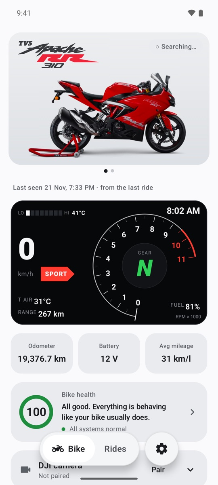
  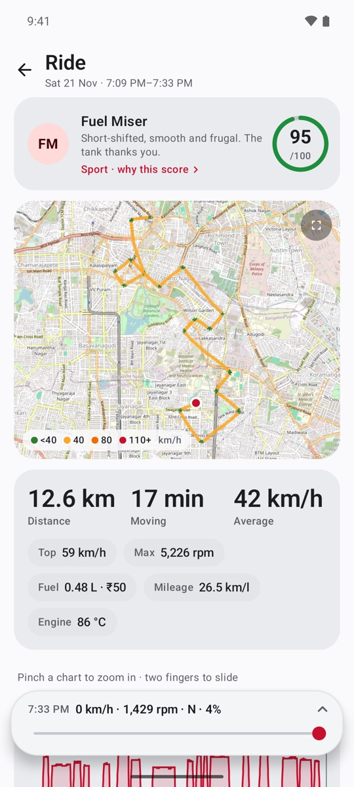
  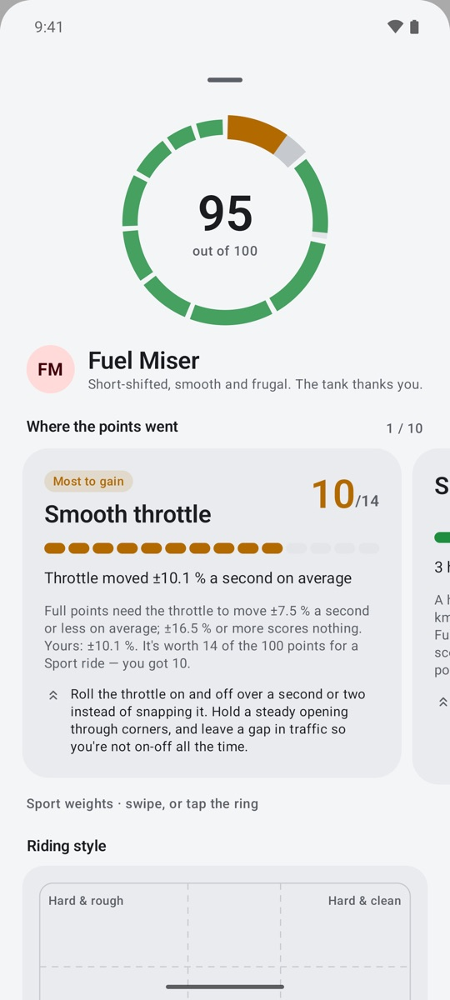

Screenshots use made-up demo rides.

**[⬇ Download the latest release](https://github.com/adarshrajendran0/RR310-Connect-releases/releases/latest)** ·
[Install guide](#install-first-time--with-obtainium) · [How to use it](#how-to-use-it)

## Connects by itself — the feature everything else builds on
Pair your bike once. From then on, **switch the ignition on and the app connects on its own** — no opening the
app, no tapping "connect", the phone stays in your pocket. It reconnects after a drop, keeps listening after the
phone restarts or the app updates, and saves battery while the bike is off.

That's what makes the rest seamless:
- **Google Maps turn-by-turn on the cluster** — start navigation as usual; arrows and distances appear on the dash
- **Every ride recorded automatically** — map, charts, fuel and mileage, and a **ride score** for every ride
- **Bike health** learned from your own rides, **fuel log** with refuels found automatically, **service reminders**
- **Documents on the bike's screen** — licence, RC and insurance, sent from your phone
- **Bike warnings**, **call alerts** (answer from the handlebar), **several bikes**, DJI Osmo Action recording

---

## How to use it

### 1 · Home — your bike at a glance

- The **bike card** shows whether it's connected (*Searching…* while the bike is off). Tap it for bike health.
- The **dash** mirrors the cluster live while you ride: speed, gear, revs, ride mode, fuel, range and temperatures.
  When the bike is off you see the last known values ("Last seen …"). Tap the dash for **full screen** (landscape,
  screen kept on — handy on a phone mount). Pick a style in Settings › Appearance › *Ride card*.
- **Bike health** — the score, the verdict and the one thing worth looking at. Tap for the full health page.

 

### 2 · More than one bike
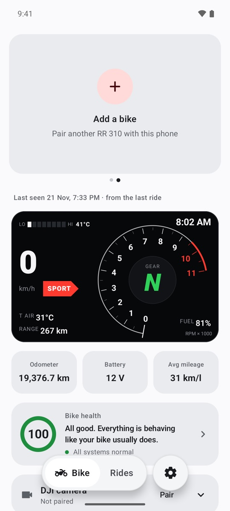

- **Swipe the bike photo left** for your next bike, or the **+ Add a bike** card at the end.
- Each bike keeps its own rides, fuel log, health, service, documents and parking spot.
- **Whichever bike you switch on connects**, and the app shows it. Swipe to another bike any time to look at its
  data; if that bike is on nearby and the connected one is parked, the connection moves over. It never moves
  mid-ride.

 

### 3 · Service, fuel, documents, parking
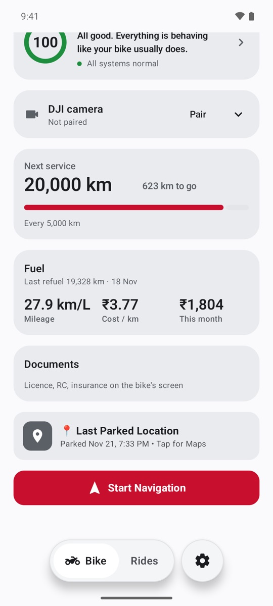

Further down the home page:
- **Next service** — counts down to the next 5,000 km service; mark it done after each visit.
- **Fuel** — mileage, cost per km and this month's spend. Tap for the fuel log.
- **Documents** — your papers on the bike's screen (below).
- **Last parked location** — saved when you switch off; tap to open it in Google Maps.
- **Start Navigation** — opens Google Maps; directions then show on the cluster by themselves.

 

### 4 · Rides — every ride, recorded for you
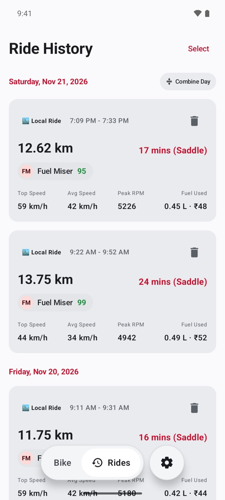

Nothing to start or stop: a ride begins when you move off and ends when you switch off.
- Each ride shows distance, saddle time, speeds, peak revs and the fuel it used, plus its **character and score**.
- **Combine Day** joins a day's short hops into one ride (and can split them again). **Select** to delete several.

 

### 5 · A ride

- The **map** is coloured by speed; tap ⛶ for full screen.
- Distance, moving time, average and top speed, peak revs, **fuel used and km/l**, engine temperature.
- **Charts** for speed, revs, throttle, temperature and more: **pinch to zoom**, two fingers to slide. The slider at
  the bottom scrubs through the ride and shows that second's speed, revs, gear and throttle.

 

### 6 · Ride score — why you got that score

Tap **why this score** on a ride.
- The **ring is the score, built from its factors**: each segment is one factor (its length is how much it counts
  in that ride mode), the coloured part is the points you earned. Amber = room to improve.
- Your **character** sums up the ride — *Fuel Miser*, *Silk Ninja*, *Throttle Goblin*…
- Scoring is judged **against the ride mode**: the same riding earns more in Track than in Rain.

 

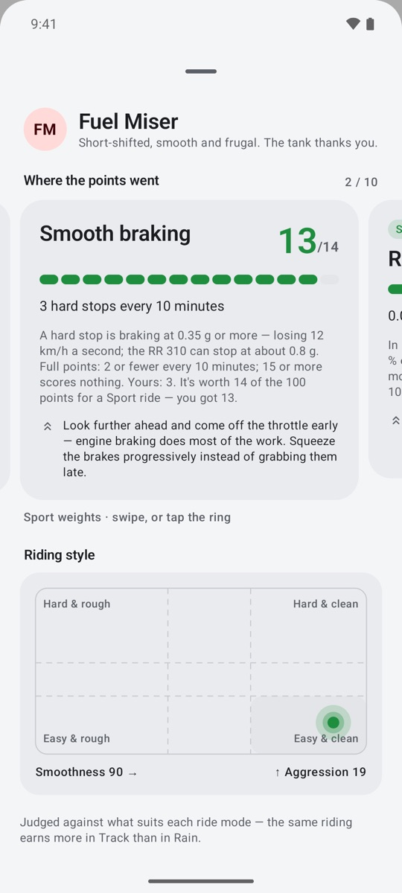

- **Swipe the factor cards** — the ring lights up the factor you're on — or **tap a ring segment** to jump to it.
  Each card shows the points as pips, what was measured, why it scored that, and **how to earn more**.
- The **riding-style map** shows where the ride sits: hard or easy, rough or clean.

 

### 7 · Bike health
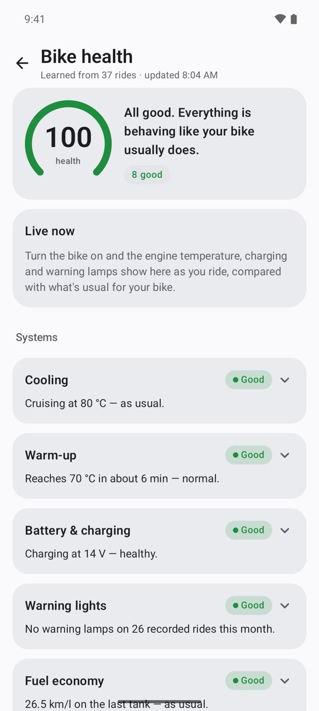

The app learns what's **normal for your bike** from your own rides — cruising temperature, warm-up time, charging
voltage, braking, mileage — and tells you when something drifts.
- One score and a verdict at the top; **Live now** compares the engine with its usual while you ride.
- **System cards** (cooling, warm-up, battery, warning lights, fuel, service, engine load, braking): collapsed, each
  shows what needs attention (red first); tap for the trend and details.
- Below: maintenance (chain, tyres, service) and your riding patterns.

 

### 8 · Fuel log
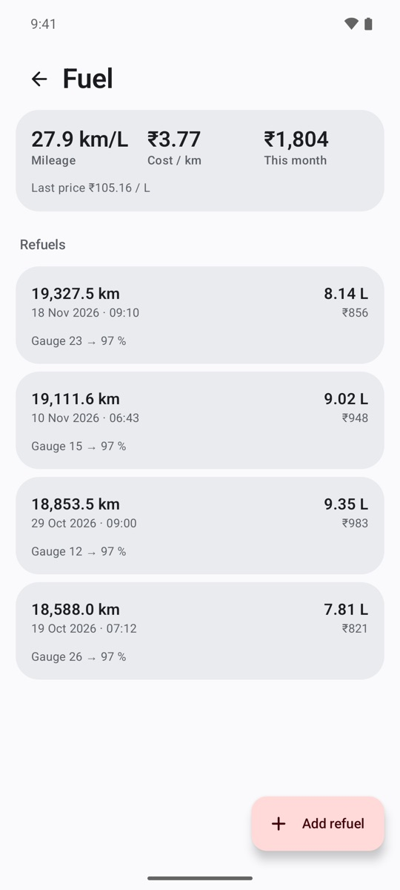

- **Refuels are found automatically** from the fuel gauge — you get a quiet notification to add the litres and
  amount from the pump (optional, but it makes mileage and cost exact).
- Mileage (full tank to full tank), cost per km, spend this month. **Add refuel** for one the app missed.

 

### 9 · Documents on the bike's screen
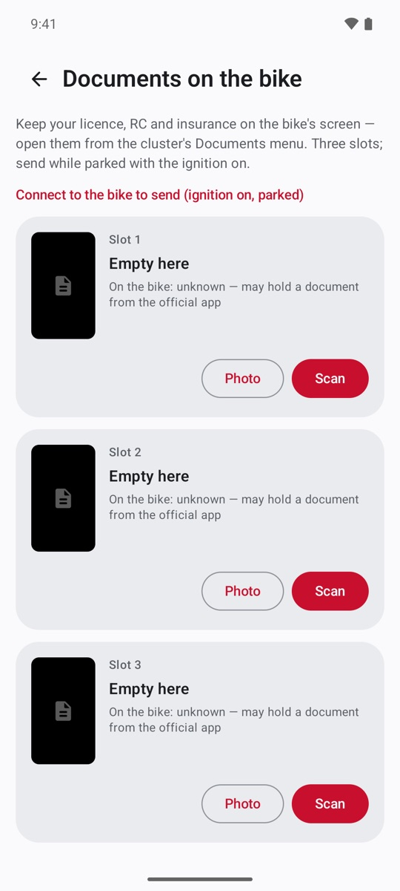

Keep your licence, RC and insurance on the cluster (open them from the bike's *Documents* menu).
1. Tap **Scan** (or **Photo**) for a slot and capture the document — it's cropped and sized for the screen.
2. With the bike **parked and the ignition on**, tap **Send**. It takes a few minutes; the app shows the time left.

 

### 10 · Settings
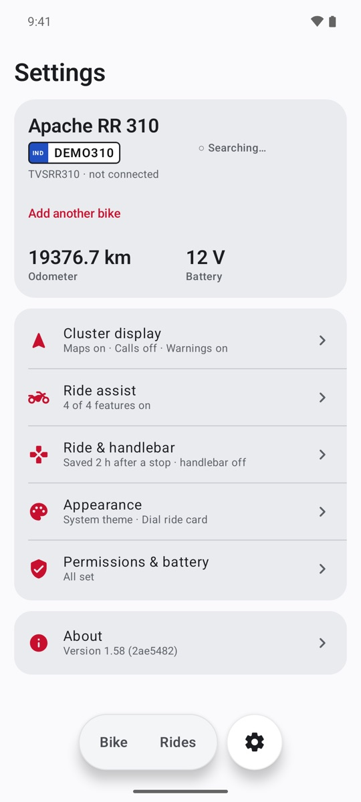

- **Your bike** — number plate, *Add another bike*, forget a bike.
- **Cluster display** — Google Maps directions, bike warning notifications, incoming calls on the cluster and
  answering with the handlebar.
- **Ride assist**, **Ride & handlebar** (when a ride ends, handlebar shortcuts), **Appearance** (theme, ride card).
- **Permissions & battery** — everything the app needs, with a *Fix* button for each.
- **About** — version, changelog, **Check for updates**, **Back up rides & settings** / **Restore**, *Report a
  problem*.

 

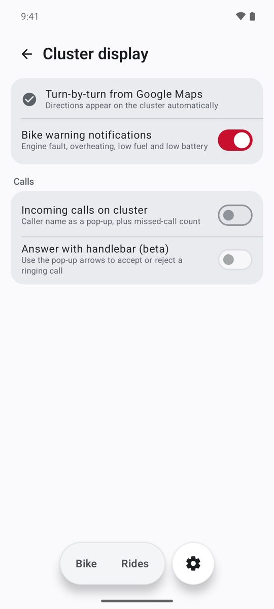

**Google Maps directions on the cluster** need *notification access*. On Android 13+ Android first blocks it for
apps installed outside the Play Store — the app walks you through it:
1. Settings › Cluster display › tap **Turn-by-turn from Google Maps** → pick *RR310 Connect* (tap OK if Android says
   "Restricted setting").
2. **Open App info** → ⋮ (top right) › **Allow restricted settings** → confirm with your PIN.
3. Back to notification access → *RR310 Connect* → **Allow**.

 

---

## Install (first time) — with Obtainium
In India, **Google Play Protect blocks this APK if you open it from a browser or the Files app** ("App blocked to
protect your device", only an OK button) — it does that to every sideloaded app that reads notifications, which
the app needs for Google Maps arrows. Installing through **Obtainium**, a free open-source app store that installs
straight from GitHub releases, works:

1. **Get Obtainium** from its [GitHub releases](https://github.com/ImranR98/Obtainium/releases/latest)
   (`app-arm64-v8a-release.apk` fits almost every phone from the last 6 years) or from F-Droid, and install it.
2. Open Obtainium › **Add app** › paste this page's address:
   `https://github.com/adarshrajendran0/RR310-Connect-releases` › **Add**.
3. Tap **Install**. The first time, Android asks to **allow Obtainium to install apps** — turn it on, go back.
4. If Play Protect shows **"App scan recommended"**: tap **Scan app** (takes a few seconds), or
   *More details › Install without scanning*.
5. Open **RR310 Connect**. It walks you through permissions and **Pair your bike** (ignition on, pick your
   "TVS…" cluster). Allow *Nearby devices*, *Location — all the time* and *Battery — unrestricted*: auto-connect
   needs them. For Google Maps directions, follow the notification-access steps above.

Works on Android 7 and newer. Have a computer with Android tools? `adb install RR310-Connect-v1.xx.apk` works too.

**Check the file** (optional): every release has a `.sha256` next to the APK — it must match
`sha256sum RR310-Connect-v1.xx.apk` (or any SHA-256 app on the phone).

## Updates
Once installed, updates come **from inside the app**: Settings › About › *Update available* shows what's new, then
**Download update** → **Install update**. Android may offer a Play Protect scan — tap *Scan app*. (Obtainium can
also keep it updated; either is fine — they install the same signed file.)

**Moving from an older version** (installed before v1.47, under the old app name)? Its *Update available* page
installs the new app and moves your rides and settings across — follow the steps on screen. In Obtainium, add this
page again: Android sees it as a new app.

**Before an update, it never hurts to back up**: Settings › About › *Back up rides & settings* (one file you keep).

## Problems or ideas
Settings › About › **Report a problem** creates a file with the phone and app details — send it to the
developer in the community group. Nothing is sent anywhere automatically.

**Use at your own risk** — this is beta software. Set it up while parked; while riding, everything appears on the
cluster.
